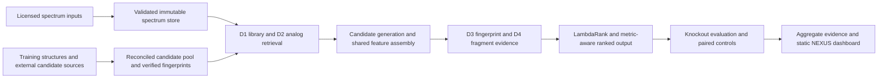

# Research architecture

CASMI26 identifies molecular structures by retrieving mass-compatible candidates and ranking chemical/spectral evidence. The implementation supports offline and Kaggle research execution. It has no hosted inference service, application backend or production deployment layer.

## Data flow

## Implementation map

| Component | Location | Responsibility |
|---|---|---|
| Chemistry | `src/casmi/chem/` | Mass/adduct conversion, canonical metric keys and molecular identity |
| Spectra | `src/casmi/spectra/` | Peak cleaning, similarity, memory-mapped storage and structural/numeric validation |
| Candidates | `src/casmi/pool/`, `src/casmi/generate/` | Source reconciliation, mass-window retrieval, fingerprint provenance and generated overlays |
| Evidence channels | `src/casmi/channels/` | D1 reference matching, D2 analog features, learned fingerprints and fragment explanations |
| Feature orchestration | `src/casmi/engine.py`, `src/casmi/predict.py` | Shared candidate/feature computation, channel integration, ranking and output handling |
| Ranking | `src/casmi/rank/` | Context features, explicit source-prior handling and seed-bagged LightGBM LambdaRank |
| Evaluation | `src/casmi/validate/` | Knockouts, query/source alignment, rank semantics, controls, bootstrap, family partitions and coverage accounting |
| Study execution | `scripts/run_*_study.py` | Declared populations, model lineage, seals, conditions and aggregate exports |
| Publication | `scripts/build_*notebook.py`, `scripts/check_*publication*.py` | Bundles, exact-source readback and bounded output validation |

## Runtime contracts

The molecule is the prediction/evaluation unit. Up to 25 ranked guesses are scored by the first tautomer-canonical InChIKey14 match; invalid or duplicate slots must not be compressed into better positions. Numerical summaries accept integer ranks 0–25, where zero is a miss. Rank scores are not calibrated chemical-identification probabilities.

`BaselineEngine` constructs candidates and initial evidence. `Predictor.features` supplies the shared D3/D4 feature path used by controlled refitted ablations, and `Predictor.rank` applies ranking/deduplication. Its operational fallback behavior is separate from scientific study runners, which fail closed on invalid source or study contracts. The fresh scientific rankers exclude `prior_*` membership features; the explicit membership-only variant is a diagnostic.

C1/C2/C3 simulations exclude references and candidate identities according to the [evaluation guide](docs/guides/evaluation.md). Generated candidates are created after the relevant exclusions. Representation-sensitive generated IDs bind canonical isomeric SMILES so shared metric identity cannot conflate different fingerprint/fragment representations.

## Artifacts and configuration

Raw inputs and large derived artifacts remain outside Git. Runtime paths are resolved by `src/casmi/config.py`; operators can set `CASMI_DATA`, `CASMI_ARTIFACTS` and `CASMI_POOL_TAG` for their approved inputs and a fresh artifact destination. Optional source builders have additional source-path settings documented by their CLI/configuration. Local machine defaults are historical conveniences, not portable dataset locations.

Stores, tagged pools, fingerprints and weight files are explicit inputs to each experiment. [Integrity checks and manifests](docs/guides/data-integrity.md) bind their identities. A matching file inventory alone does not prove a cached D2 matrix was derived correctly; decision-grade comparisons require fresh-index evidence.

The portable Python 3.12 environment is exact/hash-locked. Kaggle records its separate actual software inventory and runs with declared attachments and disabled internet. No bitwise CUDA reproducibility across hardware is promised.

## Experiment lifecycle

For the [fresh internal benchmark](docs/studies/fresh-training-family-holdout.md), query families are partitioned before fitting. Cross-fitted D3 training features prevent a query being scored by its own fitted fold. Development selects ranker stopping; all learned artifact hashes and feature lists are sealed before test feature generation. Every selected test molecule remains in the denominator.

Completed notebooks retain the source actually executed. Publication readback binds completion, public visibility, source, attachments and bounded aggregate artifacts. Updating current source or documentation does not rewrite an executed study. New scientific conclusions require a separate declared experiment; report regeneration alone supplies no new validation.

The static dashboard consumes committed profiles and the evidence registry. It neither loads model weights nor calls private data APIs. [Report ownership](reports/README.md) · [Reproduction](docs/guides/reproducibility.md) · [Scientific limits](docs/research-assessment.md).

## Completed family-purged study

The authenticated family-purged study removed 261,826 of 2,539,608 training spectra and fitted eight fresh learned artifacts. On 150 internal test molecules, expanded C3 truth coverage rose from 13 to 17 (paired change +0.0267, 95% CI [+0.0067, +0.0533]). On 150 external molecules, expanded C2/C3 MRR@25 was 0.4454/0.0466; expanded-minus-legacy ranking effects remain unresolved in the joint 11-contrast intervals. External C3 truth coverage remains only 23/150. Original-snapshot novelty gates remain unsuccessful; this is generalization relative to a rebuilt purged corpus, not independent laboratory replication. [Methods, all outcomes and limitations](reports/purged_external_review.md).

The explicit CASMI_DATA snapshot takes precedence over automatic Kaggle discovery. All reference artifacts are rebuilt from filtered rows before fitting. Undefined generic-family labels quarantine the entire affected declared identity under the outcome-blind amendment; the failed first attempt remains preserved.
