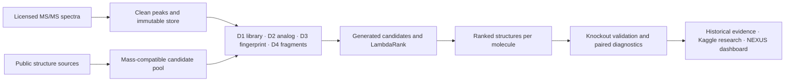

<p align="center"></p>

# CASMI26 · Molecular Identification Research

**An evidence-led, noncommercial data science portfolio:** retrieving and ranking molecular structures from tandem mass spectra under incomplete reference coverage.

[Research brief](docs/hiring-summary.md) · [Documentation](docs/README.md) · [Model card](MODEL_CARD.md) · [Kaggle notebooks](kaggle/README.md) · [Interactive research dashboard](site/index.html)

[](https://github.com/senanurcetin/enveda-casmi26/actions/workflows/nexus-research-checks.yml)

**Research review: 25 October 2026.** The competition experiment campaign stopped on 8 October. A corrected-protocol retrospective study has now completed on all 250 designated V-in molecules with frozen original weights, rebuilt inputs and paired negative controls. Historical leaderboard scores remain separate. No new competition submission or final private score is claimed.

## The research question

Can a candidate-ranking system identify unknown natural products when the correct structure may have reference spectra, may exist only in a structure database, or may be absent from every candidate source?

The original pipeline combines mass-constrained retrieval, four evidence channels, generated candidates and learned ranking. The central finding is that **a ranker can learn how its simulated candidate pool was constructed instead of learning chemical evidence**. A second finding is that adding a database can lower accuracy by introducing more mass-compatible decoys.

## Recorded results and attribution

| Historical public MRR@25 | Score | What was measured |
|---|---:|---|
| Library + analog rule | 0.190 | Own baseline |
| Ranker without membership priors | 0.258 | Own ranking system |
| + PubChemLite, retrained | 0.273 | Candidate-source extension |
| + Fragments and candidate generation | 0.298 | Structural evidence and recall |
| Extended generation | **0.309** | Best recorded own pipeline |
| External v4n base | 0.420 | Third-party solution, attributed in handoff |
| v4n + own rank-list fusion | **0.422** | Separate fusion result |

Sources: [experiment log](EXPERIMENTS.md), [historical handoff](HANDOFF.md), [machine-readable evidence registry](reports/research_evidence.json). Snapshot: **8 October 2026**. The +0.002 fusion difference is not established as a transferable or statistically significant improvement. The 0.422 result must not be attributed entirely to the original pipeline.

## What this project demonstrates

- **Scientific modeling:** MS/MS similarity, molecular fingerprints, fragment explanations, candidate generation and LightGBM LambdaRank.
- **Experimental judgment:** shortcut-feature audits, candidate coverage versus decoy cost, negative results and mismatches between offline validation and leaderboard ordering.
- **Data engineering:** immutable peak stores, candidate-source reconciliation, fingerprint provenance and content-hashed input inventories.
- **Research reliability:** molecule-level pairing, negative controls, fixed-grid simultaneous bootstrap bands and tests for rank-slot, identity and numerical edge cases.
- **Communication:** an English research narrative, model/data cards, reproducible Kaggle publication bundles and a NEXUS evidence dashboard.

## Architecture



The dashboard reads committed aggregates and evidence JSON; it serves no trained model and makes no live Kaggle or BigQuery calls. [Original solution design](ARCHITECTURE.md) · [Data card and identity boundaries](DATA_CARD.md).

## Inspect locally — no account or cloud spend

```bash
python -m http.server 8000
# Open http://localhost:8000/site/
```

The responsive dashboard includes model-attribution filters, dataset-library composition, methodology risks, searchable evidence states and a downloadable source-hashed research review. NEXUS uses the approved identity from the owner's Drive Logo folder. [Brand provenance](docs/BRAND_IDENTITY.md).

```bash
python scripts/research_evidence.py
python -m pytest tests/test_research_evidence_stdlib.py tests/test_nexus_analytics_stdlib.py -q
```

[Environment, complete test commands and full-data rebuild requirements](docs/REPRODUCIBILITY.md).


Local source-rendered desktop capture; [verification scope](docs/VERIFICATION.md). This is a historical research interface.

## Kaggle research

1. [Your Ranker Learns How You Built the Pool](https://www.kaggle.com/code/senanuretin/casmi26-your-ranker-learns-how-you-built-the-pool): simulation-induced shortcut features and placebo knockouts.
2. [A Bigger Candidate Pool Lowered My Score](https://www.kaggle.com/code/senanuretin/casmi26-a-bigger-candidate-pool-lowered-my-score): coverage gains versus decoy-window density.

**Both updated notebooks completed on Kaggle**, with matching source hashes in [publication readback](reports/kaggle_publications.json). The publication bundles retain existing input attachments, CPU execution and internet-disabled computation. Historical tables are labeled explicitly. [Build, publish and verify source/status](kaggle/README.md).

3. [Exact Public-Example Overlap Audit](https://www.kaggle.com/code/senanuretin/casmi26-exact-public-example-overlap-audit): a completed full-training scan separating exact numeric content from coarse-key collisions. [Executed results and hashes](docs/PUBLIC_EXAMPLE_OVERLAP.md).

4. [Corrected Models and Negative Controls](https://www.kaggle.com/code/senanuretin/casmi26-corrected-models-and-negative-controls): **COMPLETE**, with authenticated source/artifact readback. All 250 molecules retained; 1,710 mass-conflicting identities and 13 unparseable candidates quarantined; 1,071,863 candidate structures fingerprint-verified. [Full results, uncertainty and provenance](reports/revalidation_review.md).

| Retrospective MRR@25 | C1 | C2 | C3 |
|---|---:|---:|---:|
| D1 | 0.9033 | 0.1402 | 0.0000 |
| D1+D2 | 0.9040 | 0.2272 | 0.0000 |
| Frozen v16 learned ranker | 0.8324 | 0.6241 | 0.2374 |

The learned model trades lower C1 performance for higher C2/C3 performance in this selected population. Blank fragments reduce its C2 MRR by 0.4972 and C3 by 0.2374. Conversely, blank spectra **improve the simple models' C2 results**: mass-error tie-breaking can outperform their misleading residual similarities after truth-reference exclusion. The controls do not validate every scoring channel. [Paired confidence intervals and limits](reports/revalidation_review.md).

## Limitations that affect interpretation

V-in (250 natural-product structures) and V-real (600 harder library structures) do not establish hidden-test representativeness. Historical fusion-weight ordering did not transfer consistently. The completed corrected-protocol study evaluates frozen models retrospectively; it does not isolate the causal effect of each fix, undo historical model selection or independently attest the weights' full training lineage. A newly trained, untouched external/scaffold holdout remains a separate research requirement. Tautomer identity grouping is not scaffold independence. The [executed exact-content audit](docs/PUBLIC_EXAMPLE_OVERLAP.md) confirmed all 1,213 public-example spectra in training; they cannot serve as an independent holdout. This does not establish hidden-test contamination.

[Research assessment](docs/CASMI26_RESEARCH_ASSESSMENT.md) · [Evidence and pending work](reports/research_review.md) · [Archived maintenance notes](docs/MAINTENANCE_HISTORY.md).

## Repository map

```text
src/casmi/             chemistry, spectra, candidates, channels, ranking, validation
scripts/               data builds, audits, experiment comparisons, evidence export
notebooks/             tracked research notebook builders and local notebooks
kaggle/publications/   reproducible owned notebook bundles and input metadata
reports/               historical profile, evidence ledger and publication readback
site/                  static NEXUS research dashboard and approved assets
tests/                 synthetic scientific, provenance and integrity regressions
docs/                  reviewer guide, methodology, reproducibility and audit history
```

**Research-only scope:** no billing, customer onboarding, paid inference or recurring infrastructure. Competition data is not redistributed; source datasets and third-party notebooks retain their own terms and attribution. NEXUS is a personal brand and implies no organizer endorsement. [Contribution guidance](CONTRIBUTING.md) · [Security](SECURITY.md).

[Citation metadata](CITATION.cff). Cite the commit used and attribute input datasets and external methods separately.
