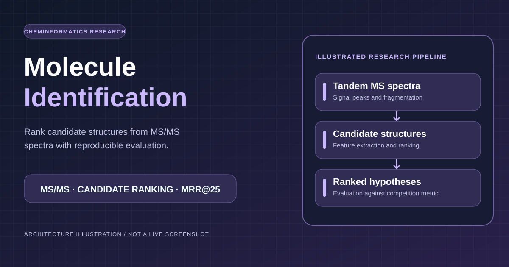

# Enveda CASMI 2026 — molecule identification from MS/MS spectra



> This is a schematic workflow illustration, **not** a competition submission image or a claim about current leaderboard rank.


Kaggle competition: [enveda-CASMI26-molecule-id-mass-spectra](https://www.kaggle.com/competitions/enveda-CASMI26-molecule-id-mass-spectra).
Given the tandem mass spectra of an unknown natural product, rank up to 25 candidate structures;
scored by MRR@25 on the tautomer-canonical InChIKey (first block).

**Project work stopped on 8 October 2026; the Kaggle competition remains open until 14 December 2026.** Best public leaderboard score **0.422**: the public v4n
fusion notebook with our own pipeline (`ranker-v16-gen2`, below) fused in as a third ranked list
(`casmi26-fusion-ours-d`). Our pipeline alone reached 0.309. The portfolio records a **public leaderboard snapshot dated 8 October 2026: 353 of 2,797 teams**; an undated earlier README snapshot recorded **348 of 2,791**. Both are historical, non-final ranks, not competing model scores. Work stopped because the remaining ideas did not
transfer to the leaderboard and a prize place (≈0.46 public) was out of reach; the hand-off and every result
are in [HANDOFF.md](HANDOFF.md).

## Approach in one paragraph

Retrieve, then rank. Candidates come from a structure pool (training structures + COCONUT +
PubChemLite, ~1.08 M) within ±10 ppm of the query's neutral mass, plus *generated* candidates:
biotransformations (methylation, glycosylation, homologs, acyl/sugar losses, …) applied to the
query's spectral analogs, for molecules that are in no database. Each candidate gets evidence from
four channels, and a LightGBM LambdaRank model trained on knockout-simulated queries ranks them:

| channel | evidence |
|---|---|
| D1 | direct library match (entropy similarity to the candidate's own spectra) |
| D2 | mass-shifted analog propagation: similarity to other structures' spectra × Tanimoto |
| D3 | spectrum → fingerprint network (set transformer), Bernoulli likelihood of the candidate fingerprint |
| D4 | fragment explanation: share of the spectrum explained by 1–2 bond cleavages of the candidate |

## What made the difference (leaderboard)

| step | public LB |
|---|---|
| direct match + analog rule | 0.190 |
| learned ranker, membership priors removed (they were simulation shortcuts) | 0.258 |
| + PubChemLite in the pool, ranker retrained on it | 0.273 |
| + D4 fragment explanation + Class-3 generated candidates | 0.298 |
| + extended transformations, 2× training queries | **0.309** |

| public v4n fusion notebook (huseyinemreaksoy et al.) as the base | 0.420 |
| + our pipeline as a third reciprocal-rank list (β 0.4, weak library matches only) | **0.422** |

Just as informative are the changes that lost on the leaderboard: bigger pools (ChEBI, LIPID MAPS,
PubChem literature), up-weighting Class 3, NP-likeness, tuned LightGBM, a larger D3, a learned bond
model and a learned spectral similarity. Each one is logged with its numbers in
[EXPERIMENTS.md](EXPERIMENTS.md). After the move to the fusion base: a heavier weight on our list (0.413),
fusion knobs of the base (0.414–0.420), and an isomer-ranking head on frozen DreaMS embeddings, which reached
MRR 0.69 on held-out Enveda-180 structures but no better than chance on real candidates, so it never shipped
([HANDOFF.md](HANDOFF.md)).

## Validation

Two held-out query sets, both at structure (skeleton) level and never used for training:
**V-in** (the 250 instrument-matched `enveda-np-examples`) and **V-real** (600 harder, held-out
library structures). V-real tracks the leaderboard's direction for pool and channel changes;
effects below ~0.01 are beyond what either set resolves. For the fusion notebook,
`notebooks/build_fusion_notebook.py --validation [--val-set test_like]` runs the whole notebook on a held-out
set and `scripts/replay_fusion.py` re-fuses its stage dumps offline; both sets ranked the fusion weights in a
different order than the leaderboard did, so they were used for direction only. Details and every decision in
[EXPERIMENTS.md](EXPERIMENTS.md); the design in [ARCHITECTURE.md](ARCHITECTURE.md).

## Reproduce

Competition data is not redistributed. Everything train-derived is rebuilt inside the Kaggle
notebook by [kaggle/submission_driver.py](kaggle/submission_driver.py) from `train.parquet` and the
public sources (COCONUT CC0, PubChemLite CC BY 4.0):

```
CASMI_RANKER=ranker-v16-gen2  CASMI_USE_PUBCHEMLITE=1  python kaggle/submission_driver.py
```

Locally, the same stages run as `scripts/build_*.py` → `scripts/make_submission.py`; ranker training
data comes from `scripts/build_rank_data.py --generate`, `scripts/merge_train_gen.py` and
`scripts/train_ranker.py`.

## Public notebooks from this project

- [CASMI26: Your Ranker Learns How You Built the Pool](https://www.kaggle.com/code/senanuretin/casmi26-your-ranker-learns-how-you-built-the-pool)
- [CASMI26: A Bigger Candidate Pool Lowered My Score](https://www.kaggle.com/code/senanuretin/casmi26-a-bigger-candidate-pool-lowered-my-score)

## NEXUS Research Intelligence (2026-10-18 extension)

A [NEXUS 2.0 research dashboard](site/index.html) now presents the **historical 8 October** model results, experimental provenance, and the source-library profile in `reports/data_profile.json`. It uses the approved NEXUS SVG and works locally with `python -m http.server 8000` (open `/site/`). **It does not represent live Kaggle or BigQuery results and does not change the frozen model or leaderboard claims.**

**Research-only scope:** No productization, service deployment, monetization, or live dashboard pipeline is planned. The staged implementation and scientific acceptance gates are in [RESEARCH_WORK_PROGRAM.md](docs/RESEARCH_WORK_PROGRAM.md). The current sprint adds query-identity and source-spectrum fingerprints to validation reports, disallows unsupported paired bootstrap claims for legacy runs, and provides offline BigQuery profile reconciliation. These updates do not change any model score or trigger a Kaggle submission.

New quality utilities include [`scripts/audit_submission.py`](scripts/audit_submission.py) for submission shape, exact test molecule coverage, candidate budget and optional canonical structure checks; a read-only [BigQuery data quality SQL template](sql/bigquery/library_quality.sql) with a safe renderer; and dependency-free regression tests in GitHub Actions. See [implementation details and limitations](docs/NEXUS-CASMI26.md).
