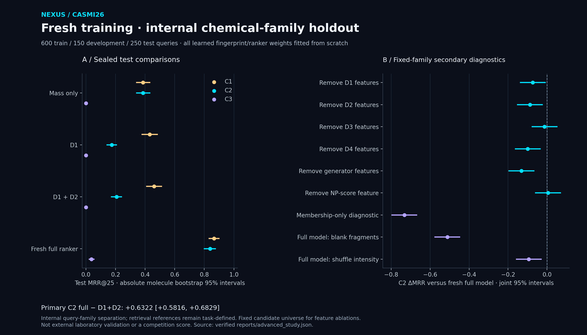

<p align="center"></p>

# CASMI26 · Molecular Identification Research

An English-first, noncommercial research project by Senanur Cetin: retrieve and rank molecular structures from tandem mass spectra when reference spectra and candidate structures may be incomplete.

[Documentation](docs/README.md) · [Architecture](ARCHITECTURE.md) · [Model card](MODEL_CARD.md) · [Data card](DATA_CARD.md) · [Kaggle](kaggle/README.md)

[](https://github.com/senanurcetin/enveda-casmi26/actions/workflows/nexus-research-checks.yml)

## Research approach

The pipeline combines mass-compatible candidates, library matching (D1), spectral analog retrieval (D2), learned molecular fingerprints (D3), fragment explanations (D4), candidate generation and LightGBM LambdaRank. Validation separates reference availability from candidate availability and scores every selected molecule, including retrieval misses.

The work examines simulation-induced shortcuts, candidate coverage versus decoy cost, spectral evidence dependence and internal chemical-family transfer. Runtime checks protect spectrum stores, molecular identities, fingerprint alignment and experiment provenance. [Implementation](ARCHITECTURE.md) · [Evaluation methodology](docs/guides/evaluation.md).

## Completed evidence

| Study | Principal finding | Evidence |
|---|---|---|
| Exact public-example audit | All 1,213 public spectra / 400 molecules match stored training content; examples are not an independent holdout | [Method and hashes](docs/studies/public-example-overlap.md) |
| Frozen-model retrospective study | All 250 V-in molecules retained; original weights assessed under corrected exclusions and spectral controls | [Results](reports/revalidation_review.md) |
| Fresh-training internal benchmark | 600/150/250 train/development/test query families; all 26 learned artifacts sealed before test features | [Design](docs/studies/fresh-training-family-holdout.md), [results](reports/advanced_review.md) |
| Candidate/ranking loss diagnosis | C3 lacks the true candidate for 224/250 queries; fixed-list oracle MRR ceiling is 0.1040 | [Descriptive decomposition](reports/candidate_loss_review.md) |
| External-source feasibility | MassBank leaves 0/491 novel molecules; expanded GNPS leaves 7/936, below the declared minimum of 30 | [Source gates and separate completed study](docs/studies/external-source-validation.md) |
| Separate purged-reference experiment | 150 external test molecules after a full-reference family purge; expanded external C2/C3 MRR 0.4454/0.0466 | [All outcomes and 11 joint contrasts](reports/purged_external_review.md) |

In the separate purged-reference study, internal C3 truth coverage increased from 13/150 to 17/150: paired change +0.0267, 95% CI [+0.0067, +0.0533]. Expanded-minus-legacy ranking gains remain unresolved. External C3 coverage is only 23/150. These findings concern a rebuilt purged corpus; original-snapshot novelty feasibility remains unsuccessful.

Fresh internal test MRR@25:

| Model | C1 | C2 | C3 |
|---|---:|---:|---:|
| Mass only | 0.3863 | 0.3863 | 0.0000 |
| D1+D2 | 0.4608 | 0.2066 | 0.0000 |
| Fresh full ranker | 0.8665 | 0.8388 | 0.0373 |

The predeclared primary C2 full-minus-D1+D2 contrast is **+0.6322**, paired 95% CI **[+0.5816, +0.6829]**. The mass-only baseline's stronger C2 result matters when interpreting that comparison. All 27 secondary contrasts, adverse findings and descriptive slices are retained. D3 and NP-score incremental benefits remain unresolved under joint uncertainty.



## Historical competition attribution

The archived 8 October 2026 author logs report **0.309 public MRR@25** for the original pipeline, **0.420** for the external v4n base and **0.422** for their rank-list fusion. The fusion score is not entirely original model work; its +0.002 difference is not established as statistically significant or transferable. These historical observations remain separate from later internal studies. [Original experiment log](EXPERIMENTS.md) · [Source-linked registry](reports/research_evidence.json).

## Inspect and reproduce

Serve the repository root to view the static NEXUS evidence dashboard:

```bash
python -m http.server 8000
# Open http://localhost:8000/site/
```

For scientific work, create a Python 3.12 environment, install the exact/hash-locked requirements and run the repository checks:

```bash
python -m pip install --require-hashes -r requirements.txt
python -m pytest tests -q
python scripts/check_research_lock.py
```

[Complete setup, report regeneration and evidence boundaries](docs/guides/reproducibility.md). The dashboard reads committed aggregates; it serves no trained model and makes no live Kaggle/BigQuery calls. [NEXUS logo provenance](docs/guides/brand-identity.md).

## Repository structure

```text
src/casmi/        scientific implementation: chemistry, spectra, retrieval, ranking, validation
scripts/          maintained builds, study runners, audits and report tools
scripts/legacy/   historical machine-specific shell chains; not the reproduction workflow
notebooks/        explanatory notebook builders; canonical outputs live in kaggle/
kaggle/           reproducible publication bundles and input metadata
protocols/        predeclared experiment designs and outcome-blind amendments
locks/            exact-version, SHA-256 dependency lock
reports/          aggregate evidence, publication readbacks and generated reviews
reports/historical/ archived tuning/validation CSVs; not new study results
runs/             ignored local outputs; only .gitkeep is tracked
docs/guides/      reproducibility, data integrity, evaluation and NEXUS identity
docs/studies/     executed-study designs and interpretation boundaries
docs/assets/      standalone research figures
site/             static evidence dashboard and approved logo assets
sql/              optional read-only warehouse analysis templates
tests/            scientific, numerical and provenance regression checks
```

## Scientific limits and use

The fresh benchmark separates selected supervised query families on existing internal sources. Shared task-defined candidate/reference knowledge, source concentration and the fixed external NP-score prior limit unseen-chemistry claims. The separate external experiment uses existing public spectra after full-reference purging. It does not establish new laboratory acquisition, independent laboratory replication or a final private competition score. Population/training differences prevent a causal before/after comparison with historical v16.

This repository is research software, without production deployment, billing or hosted inference. Licensed spectra, private per-query records, credentials and model weights are not redistributed. Source datasets and external methods retain their own terms and attribution. [Model limitations](MODEL_CARD.md#evidence-boundaries-and-failure-modes) · [Verification](docs/verification.md) · [Contribution guidance](CONTRIBUTING.md) · [Security](SECURITY.md) · [Citation metadata](CITATION.cff).
