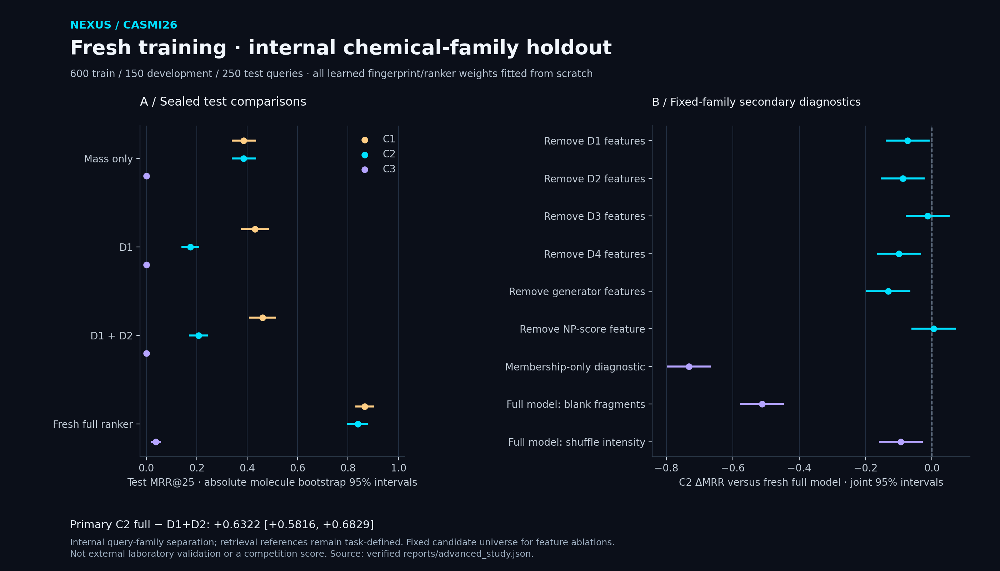

<p align="center"></p>

# CASMI26 · Molecular Identification Research

A noncommercial research project by Senanur Cetin that retrieves and ranks molecular structures from tandem mass spectra when reference spectra and candidate structures may be incomplete.

[Documentation](docs/README.md) · [Architecture](ARCHITECTURE.md) · [Model card](MODEL_CARD.md) · [Data card](DATA_CARD.md) · [Kaggle](kaggle/README.md)

[](https://github.com/senanurcetin/enveda-casmi26/actions/workflows/nexus-research-checks.yml)

## Key results

Fresh internal test MRR@25:

| Model | C1 | C2 | C3 |
|---|---:|---:|---:|
| Mass only | 0.3863 | 0.3863 | 0.0000 |
| D1+D2 | 0.4608 | 0.2066 | 0.0000 |
| Fresh full ranker | 0.8665 | 0.8388 | 0.0373 |

- Predeclared primary C2 full-minus-D1+D2 contrast: **+0.6322**, paired 95% CI **[+0.5816, +0.6829]**. All 27 secondary contrasts, adverse findings and descriptive slices are reported.
- Purged-reference study: internal C3 truth coverage rose from 13/150 to 17/150 (paired change +0.0267, 95% CI [+0.0067, +0.0533]); expanded external C2/C3 MRR 0.4454/0.0466.
- Original competition pipeline: **0.309 public MRR@25** (archived 8 October 2026 author logs).



## Quick start

Serve the repository root to view the static NEXUS dashboard:

```bash
python -m http.server 8000
# Open http://localhost:8000/site/
```

For scientific work, create a Python 3.12 environment, install the hash-locked requirements and run the checks:

```bash
python -m pip install --require-hashes -r requirements.txt
python -m pytest tests -q
python scripts/check_research_lock.py
```

The dashboard reads committed aggregates; it serves no trained model and makes no live Kaggle/BigQuery calls. See [reproducibility](docs/guides/reproducibility.md) for full setup and report regeneration, and [NEXUS logo source](docs/guides/brand-identity.md).

## Approach

The pipeline combines mass-compatible candidates, library matching (D1), spectral analog retrieval (D2), learned molecular fingerprints (D3), fragment explanations (D4), candidate generation and LightGBM LambdaRank. Validation separates reference availability from candidate availability and scores every selected molecule, including retrieval misses.

The studies examine simulation-induced shortcuts, candidate coverage versus decoy cost, spectral evidence dependence and internal chemical-family transfer. Runtime checks protect spectrum stores, molecular identities, fingerprint alignment and experiment provenance. [Implementation](ARCHITECTURE.md) · [Evaluation methodology](docs/guides/evaluation.md).

## Completed studies

| Study | Finding | Details |
|---|---|---|
| Exact public-example audit | All 1,213 public spectra / 400 molecules match stored training content | [Method and hashes](docs/studies/public-example-overlap.md) |
| Frozen-model retrospective study | All 250 V-in molecules retained; original weights assessed under corrected exclusions and spectral controls | [Results](reports/revalidation_review.md) |
| Fresh-training internal benchmark | 600/150/250 train/development/test query families; all 26 learned artifacts sealed before test features | [Design](docs/studies/fresh-training-family-holdout.md), [results](reports/advanced_review.md) |
| Candidate/ranking loss diagnosis | C3 lacks the true candidate for 224/250 queries; fixed-list oracle MRR ceiling is 0.1040 | [Descriptive decomposition](reports/candidate_loss_review.md) |
| External-source feasibility | MassBank leaves 0/491 novel molecules; expanded GNPS leaves 7/936, below the declared minimum of 30 | [Source gates and separate completed study](docs/studies/external-source-validation.md) |
| Unopened-family budget/reference comparison | 100 development / 300 new test molecules; C3 coverage 31/37/40 | [Results and paired intervals](reports/unopened_coverage_review.md) |
| Separate purged-reference experiment | 150 external test molecules after a full-reference family purge; expanded external C2/C3 MRR 0.4454/0.0466 | [All outcomes and 11 joint contrasts](reports/purged_external_review.md) |

### Competition history

The archived 8 October 2026 author logs report **0.309 public MRR@25** for the original pipeline, **0.420** for the external v4n base and **0.422** for their rank-list fusion. These are kept separate from the later internal studies. [Original experiment log](EXPERIMENTS.md) · [Source-linked registry](reports/research_evidence.json).

## Repository structure

```text
src/casmi/        scientific implementation: chemistry, spectra, retrieval, ranking, validation
scripts/          maintained builds, study runners, audits and report tools
scripts/legacy/   historical machine-specific shell chains; not the reproduction workflow
notebooks/        explanatory notebook builders; canonical outputs live in kaggle/
kaggle/           reproducible publication bundles and input metadata
protocols/        predeclared experiment designs and outcome-blind amendments
locks/            exact-version, SHA-256 dependency lock
reports/          aggregate results, publication readbacks and generated reviews
reports/historical/ archived tuning/validation CSVs; not new study results
runs/             ignored local outputs; only .gitkeep is tracked
docs/guides/      reproducibility, data integrity, evaluation and NEXUS identity
docs/studies/     executed-study designs and interpretation notes
docs/assets/      standalone research figures
site/             static dashboard and logo assets
sql/              optional read-only warehouse analysis templates
tests/            scientific, numerical and provenance regression checks
```

See also [verification](docs/verification.md), [contribution guidance](CONTRIBUTING.md), [security](SECURITY.md) and [citation metadata](CITATION.cff).

## Limitations

- **Public examples are not a holdout.** They fully overlap the training content.
- **Internal benchmark scope.** The fresh benchmark holds out selected query families from existing internal sources. Shared task-defined candidate/reference knowledge, source concentration and the fixed external NP-score prior limit conclusions about unseen chemistry. The mass-only baseline's strong C2 result matters when reading the primary contrast, and the incremental benefits of D3 and the NP score are unresolved under joint uncertainty.
- **Candidate coverage is the main bottleneck for C3**, as the loss diagnosis and coverage figures above show. In the unopened-family study the primary extended-budget gain is unresolved; in the purged study expanded-minus-legacy ranking gains are unresolved and external C3 coverage is only 23/150.
- **External validation.** The purged experiment reuses existing public spectra on a rebuilt corpus. Original-snapshot novelty was not feasible, and there is no new laboratory acquisition, independent laboratory replication or final private competition score.
- **Historical scores.** The 0.422 fusion includes the external v4n base, so it is not entirely original work, and its +0.002 gain is not shown to be significant or transferable. Population and training differences rule out a causal before/after comparison with historical v16.
- **Research software only:** no production deployment, billing or hosted inference. See [model limitations](MODEL_CARD.md#evidence-boundaries-and-failure-modes).

## License

The repository's own code, figures and documentation are released under the MIT License ([LICENSE](LICENSE)). Competition spectra, other licensed source records, private per-query records, credentials and model weights are not redistributed and are not covered by it; source datasets and upstream methods keep their own terms ([data card](DATA_CARD.md)).
