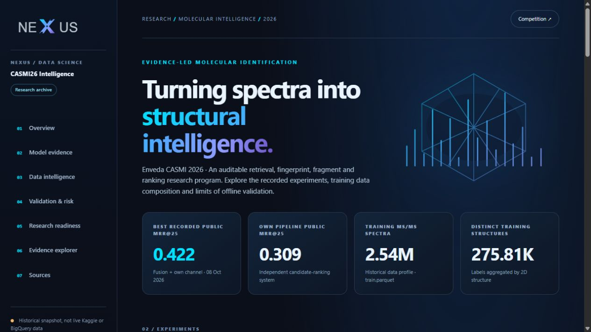
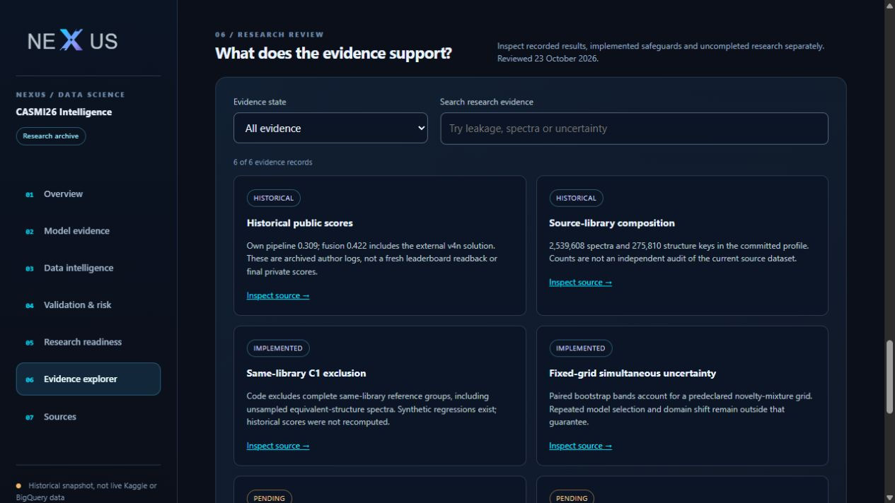
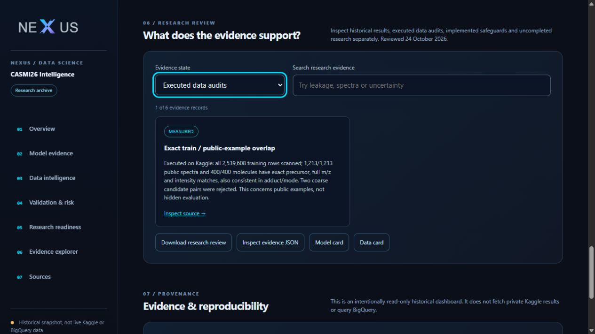

# Portfolio maintenance verification — 24 October 2026

## Delivered scope

Research positioning, reviewer documentation, model/data cards, source-linked evidence ledger, downloadable review, NEXUS dashboard evidence filters, owned Kaggle notebook editorial corrections, chart styling and reproducible publication bundles. No new full-pipeline score, paid service or competition submission.

## Executed checks

| Check | Result | Boundary |
|---|---|---|
| Full local Pytest suite | 278 passed, 2 skipped; 84 subtests passed | Synthetic/regression coverage; no licensed-data evaluation |
| New evidence-registry regressions | 3 passed | Reject duplicate IDs, unsafe/missing sources, unsupported states and invalid MRR values |
| Both notebook code-cell syntax checks | Passed | Syntax alone does not establish runtime success |
| Kaggle publication readback | Both COMPLETE, public, source hashes match | [Machine-readable readback](../reports/kaggle_publications.json); no new leaderboard scores |
| Desktop dashboard | Profile and evidence loaded; navigation and rendered status checked | Real browser accessibility and screenshot capture; no mobile/other-engine attestation |

One local skip is the Windows symlink privilege restriction; that containment case remains active on Linux CI. The other is an existing dependency/environment-conditional test. Two existing pandas dtype warnings do not affect test success. RDKit 2026.3.3 was installed into an ignored local test-dependency directory to avoid changing the shared Python installation.

The final browser review and screenshots used accessibility controls without Playwright, as requested. Prior filter/search/empty-result interaction checks were completed before that constraint was added; they were not repeated with Playwright afterward.

## Visual evidence

These are local source-rendered screenshots, not evidence of a publicly deployed web service. The historical public MRR values remain author-log records. Source-file hashes in the exported review use normalized UTF-8/LF text for consistent Windows/Linux regeneration.

CI maintenance also declares pandas/Pytest for integration modules and uses Pytest to collect their function-based regressions. Push checks run on main; pull requests run their own checks to avoid duplicate branch/PR executions.

## Executed data-evidence extension — 24 October 2026

The separate [public-example content audit](PUBLIC_EXAMPLE_OVERLAP.md) completed on Kaggle, with matching notebook source and a verified aggregate artifact hash. All 2,539,608 training rows were scanned; all 1,213 public spectra / 400 molecules matched full numerical content and acquisition mode/adduct. Two coarse candidate pairs were rejected. No hidden evaluation or model-performance conclusion follows.

Twelve initial overlap/matcher/Arrow regressions passed, followed by sixteen focused evidence/dashboard tests. The complete updated suite passed: **287 tests, 2 skipped, 96 subtests** (the same two existing pandas dtype warnings). The new measured-evidence filter was selected with browser accessibility controls and rendered exactly one of six evidence cards. No Playwright was used for this extension.

