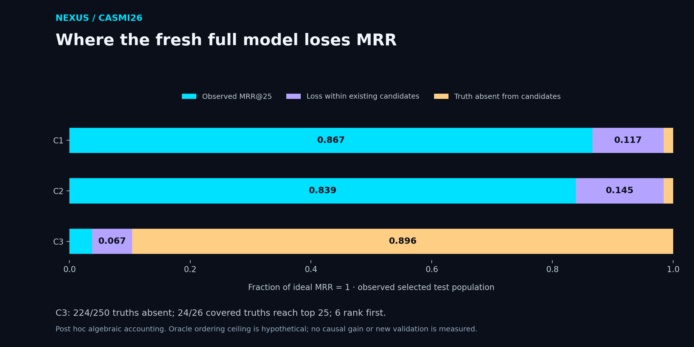

# Candidate coverage and ranking loss

This post hoc descriptive analysis reuses the authenticated completed internal test. It fits no weights, opens no new test set and selects no model. The original scores, protocol and source snapshots remain frozen.

[Vector SVG](../docs/assets/candidate-loss-budget.svg) · [PDF](../docs/assets/candidate-loss-budget.pdf)

## Full model: exact loss accounting

`1 = observed MRR + loss within covered candidates + loss from absent truth candidates`.

| Class | MRR | Candidate oracle ceiling | Absent-truth loss | Within-coverage ranking loss |
|---|---:|---:|---:|---:|
| C1 | 0.8665 | 0.9840 | 0.0160 | 0.1175 |
| C2 | 0.8388 | 0.9840 | 0.0160 | 0.1452 |
| C3 | 0.0373 | 0.1040 | 0.8960 | 0.0667 |

C3 lacks the correct candidate for **224/250 molecules**. Among the 26 covered molecules, 24 reach the top 25, 6 rank first and 2 miss the top 25. Perfect ordering of the same candidate lists could reach at most **0.1040 MRR**, a hypothetical gain of 0.0667. Improving ranking alone cannot recover absent candidates.

Conditional C3 MRR on the covered subset is 0.3591, and conditional hit@25 is 92.3%. These use only 26 molecules and must not replace the full-population MRR of 0.0373. No conditional uncertainty interval is inferred from aggregate-only evidence.

## All prespecified C3 variants

| Variant | Truth candidates | Top-25 hits | Top-1 hits | Full-population MRR | MRR given coverage |
|---|---:|---:|---:|---:|---:|
| mass_only | 0 | 0 | 0 | 0.0000 | Undefined |
| d1 | 0 | 0 | 0 | 0.0000 | Undefined |
| d1_d2 | 0 | 0 | 0 | 0.0000 | Undefined |
| full | 26 | 24 | 6 | 0.0373 | 0.3591 |
| no_d1 | 26 | 23 | 4 | 0.0315 | 0.3028 |
| no_d2 | 26 | 21 | 5 | 0.0344 | 0.3310 |
| no_d3 | 26 | 23 | 6 | 0.0372 | 0.3577 |
| no_d4 | 26 | 22 | 3 | 0.0306 | 0.2945 |
| no_gen_features | 26 | 24 | 11 | 0.0565 | 0.5434 |
| no_np_score | 26 | 24 | 6 | 0.0381 | 0.3667 |
| membership_only | 26 | 12 | 0 | 0.0054 | 0.0520 |

The larger C3 point estimate after removing generator features is already part of the prespecified secondary study. Its joint interval spans zero, so these descriptive counts do not establish superiority or justify promotion.

## Interpretation limits

- Coverage is measured on the selected candidate lists, not a universal chemistry-recall estimate.
- The oracle ceiling assumes perfect ordering of existing candidates; it is not achieved model performance.
- Conditional metrics describe only covered molecules and must not replace the full test denominator.
- Per-query joint coverage/rank observations are not exported; conditional bootstrap intervals cannot be recovered from these aggregates.
- Loss accounting is algebraic and post hoc; changing generation can alter decoys and ranking, so gains are not causally identified.
- All prespecified variants are retained; no test-selected replacement model or promotion follows.

[Source study and intervals](advanced_review.md) · [Authenticated publication](advanced_publication.json) · [Derived JSON with source hashes](candidate_loss_budget.json)
