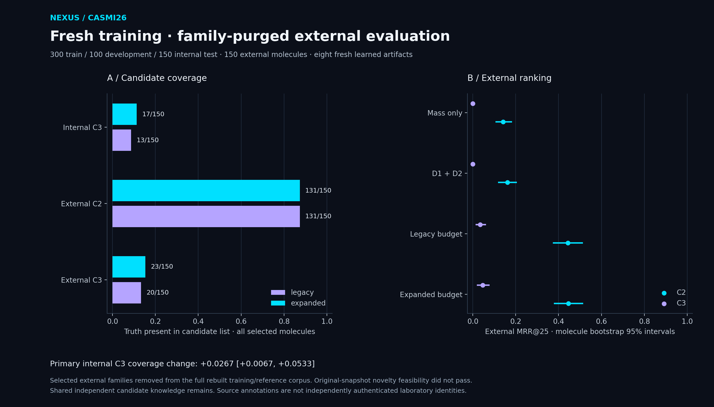

# Family-purged external evaluation and C3 budgets

This separately registered experiment evaluates freshly fitted models after removing selected external chemical families and molecular identities from the entire training/reference corpus. Original-snapshot source novelty feasibility remains unsuccessful: MassBank leaves 0/491 novel molecules and expanded GNPS leaves only 7/936. These findings are preserved; this study estimates generalization relative to a new purged training snapshot.

[Protocol](../protocols/purged-external-v1.json) · [Execution details](../protocols/purged-external-v1-execution.json) · [Aggregate](purged_external_study.json) · [Authenticated publication](purged_external_publication.json)

[Vector SVG](../docs/assets/purged-external-study.svg) · [Standalone PDF](../docs/assets/purged-external-study.pdf)

## Training/reference purge

| Quantity | Count |
|---|---:|
| Original training spectra | 2,539,608 |
| Removed spectra | 261,826 |
| Retained training spectra | 2,277,782 |
| Removed declared training identities | 20,265 |
| Undefined-family labels quarantined | 1 |
| Declared identities blocked by undefined family | 1 |
| Selected external molecules | 150 |
| Protected external family annotations | 150 |
| Retained selected external families | 0 |

All selected external standard identities, official metric identities and exact stored spectral content have zero overlap with the purged training snapshot. Every selected external family is excluded from its full reference corpus, not only from supervised query labels. Earlier internal test-family exclusions are reconstructed before filtering and preserved. Independent COCONUT/PubChemLite candidate knowledge remains available under the declared C2 semantics.

## Fresh fitting and development-only recommendation

Internal query partitions contain 300 training, 100 development and 150 test molecules with no selected query/metric/family overlap. Two fresh D3 networks supply opposite-fold training features; six fixed epochs and development-only ranker stopping precede the eight-file model seal. Membership priors and audit markers are excluded from fitted features. Fixed NP-score priors are not freshly trained.

Development C3 coverage: legacy 13/100; expanded 15/100; gains 2; losses 0. Prespecified recommended policy: **expanded**. Both fixed budgets are reported on test regardless of that recommendation.

## Primary C3 candidate-coverage comparison

Legacy: **13/150**; expanded: **17/150**. Paired change **+0.0267**, 95% percentile interval **[+0.0067, +0.0533]**, from 4,000 molecule resamples. Gains: 4; losses: 0. This is coverage, not achieved ranking accuracy.

## Internal test metrics

Every selected molecule remains in each denominator, including empty candidate lists and uncovered truths.

| Model | Condition | Class | n | MRR@25 [95% CI] | Top 1 | Top 10 | Hit 25 |
|---|---|---|---:|---:|---:|---:|---:|
| legacy | none | C1 | 150 | 0.8143 [0.7589, 0.8676] | 0.7600 | 0.9267 | 0.9400 |
| legacy | none | C2 | 150 | 0.7536 [0.6934, 0.8099] | 0.6867 | 0.9000 | 0.9133 |
| legacy | none | C3 | 150 | 0.0246 [0.0070, 0.0478] | 0.0133 | 0.0600 | 0.0733 |
| expanded | none | C1 | 150 | 0.8442 [0.7923, 0.8933] | 0.8000 | 0.9333 | 0.9333 |
| expanded | none | C2 | 150 | 0.7746 [0.7144, 0.8305] | 0.7133 | 0.9000 | 0.9067 |
| expanded | none | C3 | 150 | 0.0405 [0.0172, 0.0682] | 0.0200 | 0.0867 | 0.0933 |
| mass_only | none | C1 | 150 | 0.4136 [0.3503, 0.4772] | 0.2867 | 0.6800 | 0.8067 |
| mass_only | none | C2 | 150 | 0.4136 [0.3503, 0.4772] | 0.2867 | 0.6800 | 0.8067 |
| mass_only | none | C3 | 150 | 0.0000 [0.0000, 0.0000] | 0.0000 | 0.0000 | 0.0000 |
| d1 | none | C1 | 150 | 0.4177 [0.3469, 0.4914] | 0.3600 | 0.5667 | 0.6733 |
| d1 | none | C2 | 150 | 0.1793 [0.1356, 0.2279] | 0.0933 | 0.4067 | 0.5533 |
| d1 | none | C3 | 150 | 0.0000 [0.0000, 0.0000] | 0.0000 | 0.0000 | 0.0000 |
| d1_d2 | none | C1 | 150 | 0.4396 [0.3712, 0.5118] | 0.3600 | 0.6067 | 0.7800 |
| d1_d2 | none | C2 | 150 | 0.2006 [0.1572, 0.2480] | 0.0800 | 0.4467 | 0.6800 |
| d1_d2 | none | C3 | 150 | 0.0000 [0.0000, 0.0000] | 0.0000 | 0.0000 | 0.0000 |

## External test metrics

Every selected molecule remains in each denominator, including empty candidate lists and uncovered truths.

| Model | Condition | Class | n | MRR@25 [95% CI] | Top 1 | Top 10 | Hit 25 |
|---|---|---|---:|---:|---:|---:|---:|
| legacy | none | C2 | 150 | 0.4437 [0.3733, 0.5134] | 0.3600 | 0.6333 | 0.7200 |
| legacy | none | C3 | 150 | 0.0342 [0.0128, 0.0615] | 0.0200 | 0.0667 | 0.0933 |
| legacy | blank | C2 | 150 | 0.2067 [0.1553, 0.2602] | 0.1267 | 0.3733 | 0.5333 |
| legacy | blank | C3 | 150 | 0.0000 [0.0000, 0.0000] | 0.0000 | 0.0000 | 0.0000 |
| expanded | none | C2 | 150 | 0.4454 [0.3779, 0.5144] | 0.3400 | 0.6267 | 0.7267 |
| expanded | none | C3 | 150 | 0.0466 [0.0196, 0.0785] | 0.0333 | 0.0800 | 0.1067 |
| expanded | blank | C2 | 150 | 0.1987 [0.1512, 0.2486] | 0.1000 | 0.4067 | 0.5533 |
| expanded | blank | C3 | 150 | 0.0000 [0.0000, 0.0000] | 0.0000 | 0.0000 | 0.0000 |
| mass_only | none | C2 | 150 | 0.1419 [0.1057, 0.1831] | 0.0533 | 0.3467 | 0.5800 |
| mass_only | none | C3 | 150 | 0.0000 [0.0000, 0.0000] | 0.0000 | 0.0000 | 0.0000 |
| mass_only | blank | C2 | 150 | 0.1419 [0.1057, 0.1831] | 0.0533 | 0.3467 | 0.5800 |
| mass_only | blank | C3 | 150 | 0.0000 [0.0000, 0.0000] | 0.0000 | 0.0000 | 0.0000 |
| d1 | none | C2 | 150 | 0.0930 [0.0680, 0.1214] | 0.0133 | 0.2800 | 0.4733 |
| d1 | none | C3 | 150 | 0.0000 [0.0000, 0.0000] | 0.0000 | 0.0000 | 0.0000 |
| d1 | blank | C2 | 150 | 0.1419 [0.1057, 0.1831] | 0.0533 | 0.3467 | 0.5800 |
| d1 | blank | C3 | 150 | 0.0000 [0.0000, 0.0000] | 0.0000 | 0.0000 | 0.0000 |
| d1_d2 | none | C2 | 150 | 0.1613 [0.1180, 0.2056] | 0.0733 | 0.3200 | 0.5267 |
| d1_d2 | none | C3 | 150 | 0.0000 [0.0000, 0.0000] | 0.0000 | 0.0000 | 0.0000 |
| d1_d2 | blank | C2 | 150 | 0.1419 [0.1057, 0.1831] | 0.0533 | 0.3467 | 0.5800 |
| d1_d2 | blank | C3 | 150 | 0.0000 [0.0000, 0.0000] | 0.0000 | 0.0000 | 0.0000 |

## Candidate coverage ceilings

| Cohort | Policy | Class | Truth present | Oracle MRR ceiling | Mean / maximum candidates |
|---|---|---|---:|---:|---:|
| internal | legacy | C1 | 147/150 | 0.9800 | 131.7 / 709 |
| internal | legacy | C2 | 147/150 | 0.9800 | 126.3 / 709 |
| internal | legacy | C3 | 13/150 | 0.0867 | 125.4 / 708 |
| internal | expanded | C1 | 147/150 | 0.9800 | 158.5 / 931 |
| internal | expanded | C2 | 147/150 | 0.9800 | 150.4 / 932 |
| internal | expanded | C3 | 17/150 | 0.1133 | 149.5 / 931 |
| external | legacy | C2 | 131/150 | 0.8733 | 179.4 / 935 |
| external | legacy | C3 | 20/150 | 0.1333 | 178.6 / 935 |
| external | expanded | C2 | 131/150 | 0.8733 | 219.5 / 1255 |
| external | expanded | C3 | 23/150 | 0.1533 | 218.8 / 1255 |

Oracle ceilings assume perfect ordering of the existing lists. They are hypothetical bounds, not achieved accuracy. The three diagnostic baseline rules use original-pool candidates and cannot recover a removed C3 truth.

## Fixed-family joint secondary uncertainty

All 11 registered contrasts share a joint max-deviation bootstrap radius. Molecules are paired within each cohort and independently resampled across cohorts; absolute model intervals above do not replace these paired comparisons. No adverse comparison is omitted.

| Comparison | Cohort | Difference [joint 95% CI] |
|---|---|---:|
| external_mrr_expanded_minus_legacy:C2 | external | +0.0017 [-0.0675, +0.0710] |
| external_coverage_expanded_minus_legacy:C2 | external | +0.0000 [-0.0692, +0.0692] |
| external_legacy_blank_minus_none:C2 | external | -0.2370 [-0.3062, -0.1678] |
| external_expanded_blank_minus_none:C2 | external | -0.2467 [-0.3160, -0.1775] |
| external_mrr_expanded_minus_legacy:C3 | external | +0.0123 [-0.0569, +0.0816] |
| external_coverage_expanded_minus_legacy:C3 | external | +0.0200 [-0.0492, +0.0892] |
| external_legacy_blank_minus_none:C3 | external | -0.0342 [-0.1035, +0.0350] |
| external_expanded_blank_minus_none:C3 | external | -0.0466 [-0.1158, +0.0226] |
| internal_mrr_expanded_minus_legacy:C1 | internal | +0.0299 [-0.0394, +0.0991] |
| internal_mrr_expanded_minus_legacy:C2 | internal | +0.0210 [-0.0482, +0.0902] |
| internal_mrr_expanded_minus_legacy:C3 | internal | +0.0159 [-0.0534, +0.0851] |

## Interpretation and limits

- External standard/metric novelty is computationally audited against the executed training snapshot; source annotations are not independently authenticated laboratory identity.
- When a family-purged snapshot is used, original-snapshot source novelty feasibility remains unsuccessful; external-family generalization is relative to the rebuilt filtered corpus.
- External collision energy is not harmonized to eV; unavailable numeric eV is encoded zero. This is a distribution-shift limitation.
- External libraries have a restricted chemical/instrument distribution and are not a representative clinical or environmental population.
- Generic-family supervised separation does not remove task-defined shared candidate knowledge or fixed NP-score priors.
- Both predeclared budgets and every adverse outcome are retained. Positive generator improvement is not guaranteed.
- Historical study populations, fitting and architecture differ; direct score comparison does not isolate improvement.
- No competition submission, paid infrastructure, service deployment or raw competition-record export.

The historical 600/150/250 benchmark used a different training/reference corpus and population. Direct MRR comparison does not isolate a causal improvement. External spectra come from public source annotations, not an independent laboratory replication. The family-balanced source sample is not population prevalence. Unknown numeric collision energy is encoded zero, with no NCE/percent-to-eV conversion.

No commercial service, billing, paid infrastructure, deployment, raw competition-record redistribution or competition submission is part of this project.
