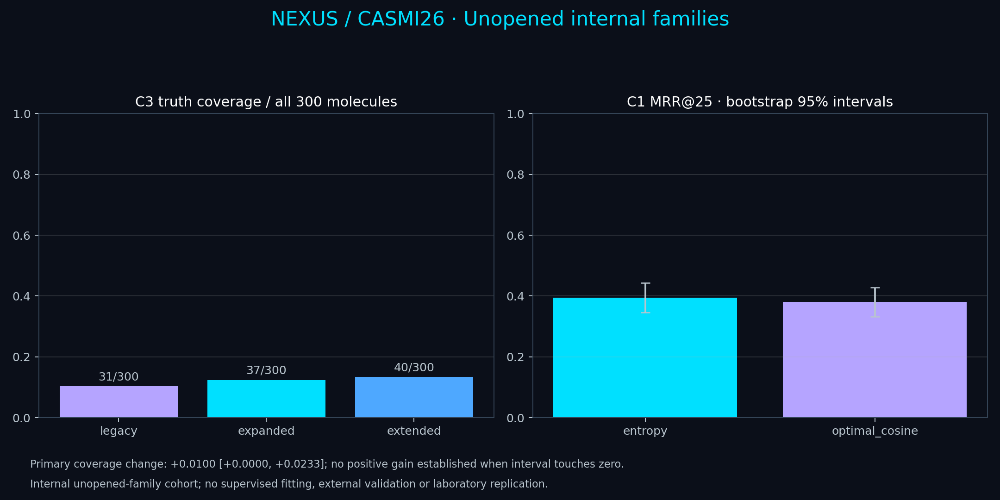

# Unopened internal-family coverage and reference comparison

This separately registered study protects all previously selected query families and evaluates new internal families. It fits no supervised model and does not establish external or laboratory replication. Candidate truth coverage is not achieved C3 ranking accuracy.

[Protocol](../protocols/unopened-coverage-v1.json) · [Aggregate](unopened_coverage_study.json) · [Authenticated publication](unopened_coverage_publication.json)

[Vector figure](../docs/assets/unopened-coverage.svg) · [PDF](../docs/assets/unopened-coverage.pdf)

Development molecules: 100; test molecules: 300. Development recommendation: **extended**, with 5 gains and 0 losses versus expanded. Both larger budgets remain reported regardless of this choice.

## C3 candidate coverage

| Fixed policy | Covered / all test molecules | Mean candidates | Maximum candidates |
|---|---:|---:|---:|
| legacy | 31/300 | 123.6 | 911 |
| expanded | 37/300 | 153.1 | 1031 |
| extended | 40/300 | 204.7 | 1814 |

Primary extended-minus-expanded coverage change: **+0.0100 [+0.0000, +0.0233]**, paired 95% percentile interval from 4,000 molecule resamples. Gains: 3; losses: 0. All 300 molecules remain in every denominator.

The proposal caps apply to generated candidates; ordinary mass-compatible pool candidates are additional. The extended policy preserves earlier proposals before filling its cap. A primary interval touching zero does not establish a strictly positive population benefit.

## C1 reference scoring

| Scorer | MRR@25 [95% CI] | Top 1 | Top 10 | Hit 25 |
|---|---:|---:|---:|---:|
| entropy | 0.3945 [0.3465, 0.4437] | 0.3200 | 0.5567 | 0.6967 |
| optimal_cosine | 0.3801 [0.3325, 0.4281] | 0.3067 | 0.5500 | 0.6967 |

C1 removes all same-library metric-equivalent truth acquisitions. Direct scorers need an eligible cross-library reference to supply truth spectral evidence; queries without one remain in the denominator. Raw-intensity optimal cosine and intensity-weighted entropy have different objectives. An absolute interval does not establish a between-scorer gain.

## Joint secondary comparisons

| Comparison | Difference [joint 95% CI] |
|---|---:|
| C3_coverage_expanded_minus_legacy | +0.0200 [+0.0033, +0.0367] |
| C1_MRR_optimal_cosine_minus_entropy | -0.0145 [-0.0311, +0.0022] |

The two registered secondary comparisons share a molecule-paired max-deviation radius. Coverage differences retain binary-coverage units even though the generic interval record uses the field name delta_mrr. No adverse result is suppressed.

## Limits

- New internal query-family cohort; no external or laboratory replication.
- No learned D3/NP-score ablation or state-of-the-art superiority estimate.
- Candidate-coverage improvement does not establish achieved C3 ranking accuracy.
- Historical sources and shared task-defined candidate knowledge remain.
- Both positive and negative outcomes are retained.

No learned D3/NP-score ablation was performed. These unresolved effects cannot be declared resolved by this study. Historical studies use different populations; direct score comparisons do not isolate causal improvement. Source annotations remain computationally checked, not independently authenticated laboratory measurements.
